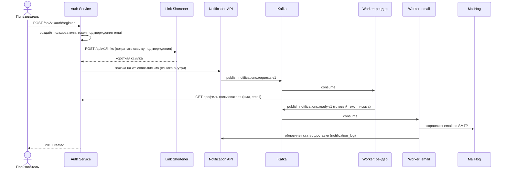
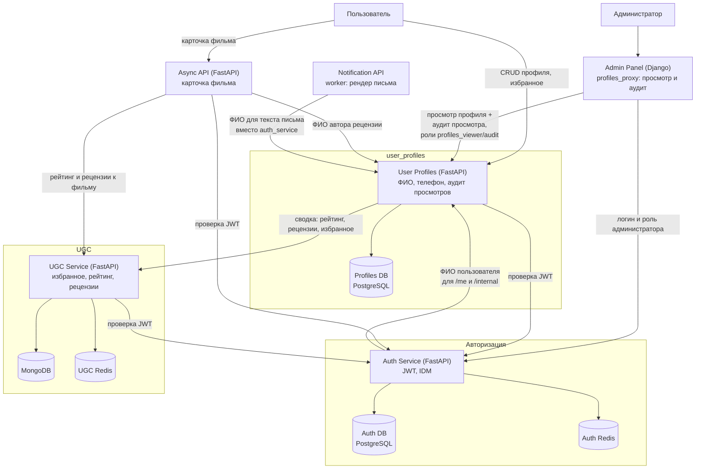

# Архитектура проекта — обзорная схема

Этот файл — не часть контракта проекта, а рабочий материал для
самоподготовки: актуальная схема сервисов (по состоянию на S11,
`docker-compose.yml`) и пример потока данных между ними, в mermaid.

## Как этим пользоваться

Mermaid — язык описания диаграмм прямо в Markdown. Блок ```` ```mermaid ... ``` ````
превращается в картинку тем, кто его рендерит:

- **GitHub** — рендерит автоматически при просмотре `.md`-файла в репозитории
  (достаточно закоммитить и открыть файл на github.com).
- **VS Code** — расширение "Markdown Preview Mermaid Support" (или
  встроенный предпросмотр в свежих версиях): `Ctrl+Shift+V` на этом файле.
- **https://mermaid.live** — вставить код блока без обёртки ```` ```mermaid ```` —
  если нужно быстро поправить и экспортировать в PNG/SVG для слайда.

Редактировать схему просто: это текст — добавить узел — дописать строку вида
`A --> B`, убрать связь — удалить строку. Можно не бояться ломать разметку —
при ошибке синтаксиса рендерер просто покажет текст ошибки вместо картинки.

## 1. Схема сервисов и их взаимодействия

Сервисы сгруппированы по доменам (как `System_Boundary` в старых
`docs/architecture_*.puml`, но в mermaid и с учётом всех сервисов, которые
появились после S8: `event_api`, `notification_*`, `link_shortener_service`,
`user_profiles`, `ugc_service`, `analytics_etl`).

```mermaid
flowchart TD
    viewer["Пользователь"]
    admin["Контент-администратор"]
    google["Google OAuth"]

    subgraph content["Контент и каталог"]
        nginx["Nginx"]
        admin_panel["Admin Panel (Django)"]
        movie_db[("Movie DB<br/>PostgreSQL")]
        async_api["Async API (FastAPI)"]
        es[("Elasticsearch")]
        async_redis[("Async API Redis")]
        fulltext_etl["Fulltext ETL"]
    end

    subgraph auth["Авторизация"]
        auth_service["Auth Service (FastAPI)<br/>JWT, OAuth, RBAC/IDM"]
        auth_pg[("Auth DB<br/>PostgreSQL")]
        auth_redis[("Auth Redis")]
    end

    subgraph profiles["Профили и UGC"]
        user_profiles["User Profiles (FastAPI)"]
        profiles_pg[("Profiles DB<br/>PostgreSQL")]
        ugc_service["UGC Service (FastAPI)<br/>лайки, закладки, рецензии"]
        mongo[("MongoDB Cluster<br/>sharded")]
        ugc_redis[("UGC Redis")]
    end

    subgraph links["Короткие ссылки"]
        link_shortener["Link Shortener (FastAPI)"]
        links_pg[("Links DB<br/>PostgreSQL")]
    end

    subgraph events["События и аналитика"]
        event_api["Event API (FastAPI)"]
        kafka{{"Kafka"}}
        analytics_etl["Analytics ETL"]
        clickhouse[("ClickHouse")]
    end

    subgraph notify["Уведомления"]
        notification_api["Notification API (FastAPI)"]
        notification_pg[("Notification DB<br/>PostgreSQL")]
        notification_worker_render["Worker: рендер"]
        notification_worker_email["Worker: отправка email"]
        mailhog["MailHog (SMTP-мок)"]
        notification_admin["Notification Admin Panel (Django)"]
        notification_cron["Cron"]
    end

    %% Клиенты
    viewer --> async_api
    viewer --> auth_service
    viewer --> event_api
    viewer --> user_profiles
    viewer --> ugc_service
    viewer -->|резолв короткой ссылки| link_shortener
    viewer -. вход через Google .-> google

    admin --> nginx
    admin --> notification_admin
    admin -->|управление ролями /idm| auth_service
    admin -. вход через Google .-> google

    %% Контент и каталог
    nginx --> admin_panel
    admin_panel --> movie_db
    admin_panel -->|логин и роль| auth_service
    fulltext_etl --> movie_db
    fulltext_etl --> es
    async_api --> es
    async_api --> async_redis
    async_api -->|кто пользователь?| auth_service

    %% Авторизация
    auth_service --> auth_pg
    auth_service --> auth_redis
    auth_service -. обмен кода OAuth .-> google
    auth_service -->|ссылка подтверждения email| link_shortener
    auth_service -->|welcome-письмо| notification_api

    %% Профили и UGC
    user_profiles --> profiles_pg
    user_profiles -->|проверка токена| auth_service
    user_profiles -->|сводка UGC| ugc_service
    ugc_service --> mongo
    ugc_service --> ugc_redis
    ugc_service -->|проверка токена| auth_service

    %% Короткие ссылки
    link_shortener --> links_pg

    %% События и аналитика
    event_api -->|публикует события| kafka
    kafka --> analytics_etl
    analytics_etl --> clickhouse

    %% Уведомления
    notification_api -->|публикует заявку| kafka
    notification_api --> notification_pg
    kafka --> notification_worker_render
    notification_worker_render -->|профиль пользователя| auth_service
    notification_worker_render -->|готовый текст| kafka
    kafka --> notification_worker_email
    notification_worker_email --> mailhog
    notification_worker_email -->|статус доставки| notification_pg
    notification_admin --> notification_pg
    notification_admin -->|HTTP API| notification_api
    notification_cron -->|HTTP API| notification_api
```



**Как читать:** шесть доменных блоков (`subgraph`) — это границы
ответственности команды (похоже на то, что в C4-диаграмме называется
"System_Boundary"). `auth_service` — центральный узел: почти все сервисы
проверяют через него токен пользователя (стрелки "проверка токена" /
"кто пользователь?"). Jaeger (трейсинг) и все `*_migrations`-контейнеры
не показаны — это инфраструктурные детали, не бизнес-поток.

## 2. Пример потока: регистрация пользователя → письмо-подтверждение

Чтобы показать на защите не только "что из чего состоит", но и "как это
работает" — вот конкретный сценарий в виде **sequence-диаграммы** (другой
тип mermaid-схемы, показывает порядок вызовов во времени):



Такую же диаграмму можно сделать для любого другого сквозного сценария
(например: клик пользователя → `event_api` → Kafka → `analytics_etl` →
ClickHouse) — достаточно скопировать блок `sequenceDiagram` и поменять
участников и шаги.

## 3. Итоговый модуль S11 — `user_profiles` и его связи

Та же нотация, что в разделе 1, но вырезан только финальный спринт
(`user_profiles`) и модули, с которыми он реально связан по коду (а не
вся платформа — см. [[project_diploma_defense_scope]] в памяти: базовая
платформа у всех групп одинаковая, на защите в фокусе только S11).
Связи сверены с кодом по состоянию на `main` (не из документации, а
прямым чтением клиентов):



**Как читать:**

- Центр схемы — `user_profiles` (своя БД, проверка токена через
  `auth_service`, запрос сводки UGC из `ugc_service` для агрегирующей
  витрины `/full`, T6).
- `admin_panel` и `async_api` — два реальных "фасада", через которые
  пользователи модуля видят его данные: админка (просмотр + обязательный
  аудит, T5/T10) и карточка фильма (рейтинг/рецензии + ФИО автора
  рецензии, T7).
- Стрелка `auth_service --> user_profiles` (S2S за ФИО) — это **обратная
  зависимость**, возникшая из-за T4 (`auth_service` отдал хранение
  ФИО в `user_profiles` и теперь сам же ходит за ним обратно). Именно
  она стала пунктом код-ревью `#131`/`S11_R2` — risk 401 по таймауту,
  если `user_profiles` недоступен; закрыт деградацией (имя подставляется
  пустым/«Аноним», а не 500).
- `notification_api` показан отдельной стрелкой по той же причине — после
  T4 воркер рендера письма перестал брать ФИО из `auth_service` и ходит
  в `user_profiles` напрямую. Остальная внутренняя механика
  уведомлений (Kafka, воркеры, MailHog) не относится к S11 и не
  показана — см. полную схему в разделе 1.
- `ugc_service` целиком переиспользован "как есть" (закладки/рейтинг/
  рецензии не продублированы внутри `user_profiles`) — на схеме он
  показан как отдельный блок с его собственными хранилищами (Mongo,
  Redis), а не как часть `user_profiles`.

## Мини-шпаргалка по синтаксису mermaid

- `flowchart TD` / `flowchart LR` — блок-схема сверху-вниз / слева-направо.
- `A --> B` — сплошная стрелка; `A -->|текст| B` — с подписью.
- `A -.-> B` — пунктирная стрелка (для внешних/необязательных связей).
- `subgraph имя["Заголовок"] ... end` — группировка узлов в рамку.
- Формы узлов: `A["прямоугольник"]`, `A(("круг"))`, `A[("база данных")]`,
  `A{{"шестиугольник"}}`, `A{"ромб (решение)"}`.
- `sequenceDiagram` — отдельный тип диаграммы: `participant X as Имя`,
  `X->>Y: сообщение` (запрос), `X-->>Y: сообщение` (ответ/пунктир).

Файл можно смело редактировать прямо в этом `.md` — после правок просто
переоткрыть предпросмотр.
